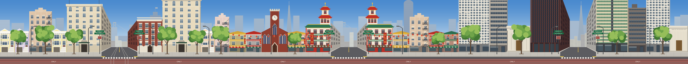

# Sam Altman Run

A 2D side-scrolling runner built in Unreal Engine (Paper2D), set in San Francisco.

## Current state: the city (no characters, no cars yet)

The first level runs along **California Street** and is based on the classic view from Nob Hill
looking east toward the Bay Bridge. It has three real intersections, each 3840 px (Unreal units) wide:

| # | Corner | Look |
|---|--------|------|
| 1 | California & Powell (Nob Hill) | Grand stone hotels, brick club, painted-lady Victorians, cable-car line crossing |
| 2 | California & Grant (Chinatown) | Pagoda-roof corner buildings, Old St. Mary's-style brick clock-tower church, lanterns |
| 3 | California & Kearny (Financial District) | Dark granite tower, white grid tower, green-striped tower, columned stone bank |

The Bay Bridge sits on the horizon in every corner, and the red cable-car lane runs along the street.



Each corner is split into parallax layers: `Sky`, `BayBridge`, `Skyline`, `Buildings`, `Street`, `Props`.

## Layout

```
SamAltmanRun.uproject        Unreal project (Paper2D + Python plugins)
Config/                      Project settings
Art/Source/City/             Generated source PNGs (imported by the editor script)
Art/Preview/                 Composited previews of each corner
Tools/CityGen/               Python generator that draws the city art
Content/Python/              Editor script that builds the level in Unreal
```

## Regenerate the art

```bash
python3 -m pip install pillow
python3 Tools/CityGen/generate_sf_city.py
```

## Build the level in Unreal

1. Open `SamAltmanRun.uproject` (UE 5.8).
2. **Tools > Execute Python Script...** and pick `Content/Python/build_sf_city.py`.
3. This creates `/Game/Maps/L_SF_CaliforniaStreet` with every layer placed, an orthographic
   side camera, a PlayerStart, and an invisible floor on the sidewalk (Z = 150).

## Unreal MCP (let Claude drive the editor)

The project enables the `ModelContextProtocol` and `AllToolsets` plugins, and `.mcp.json` points
Claude Code at `http://127.0.0.1:8000/mcp`. Turn on auto-start once per machine by creating
`Saved/Config/MacEditor/EditorPerProjectUserSettings.ini` with:

```ini
[/Script/ModelContextProtocolEngine.ModelContextProtocolSettings]
bAutoStartServer=True
```

Or run `ModelContextProtocol.StartServer` in the editor console.
